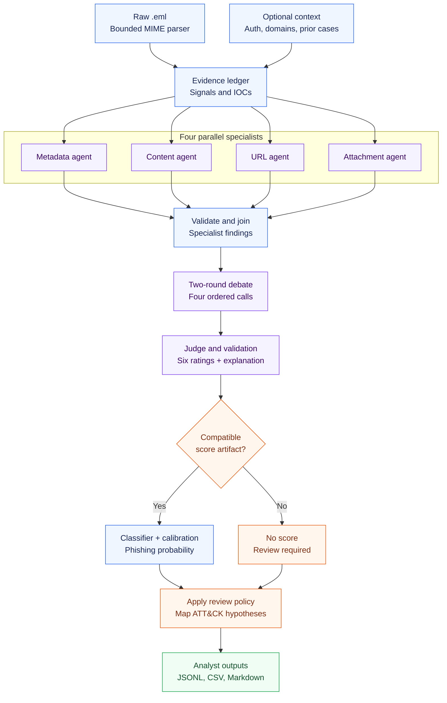
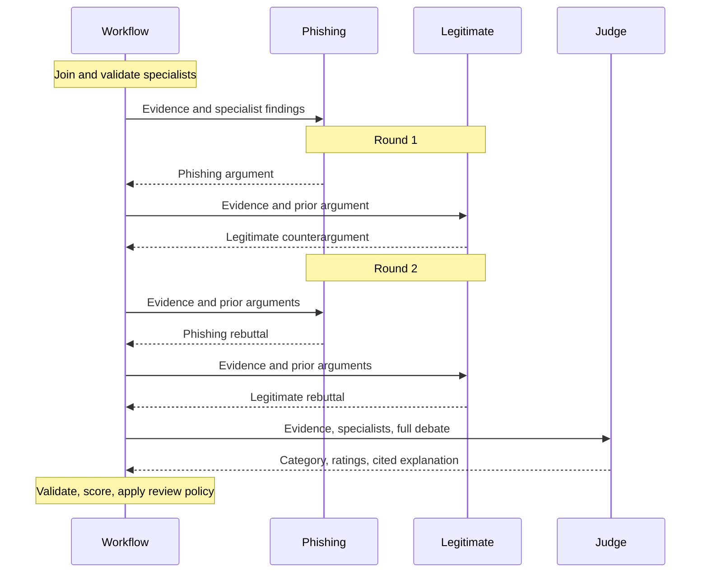
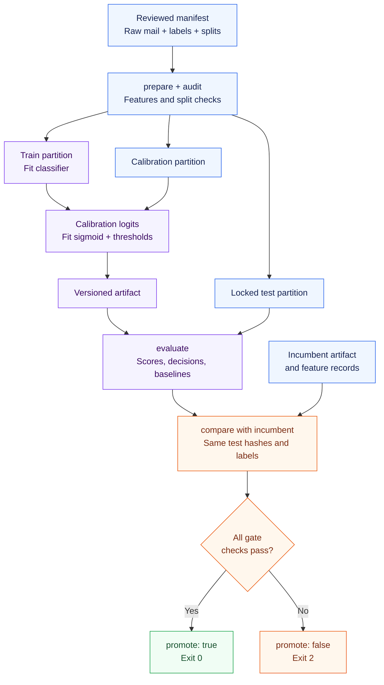

# Agentic Email Triage

### From a suspicious email to an evidence-linked investigation report


An analyst-facing Python application that examines email headers, message text, links, and attachments through **four specialist LLM agents**, a **two-round debate**, and an **evidence-anchored judge**. It produces a readable incident report and structured records for review and evaluation.

> [!IMPORTANT]
> **What works today:** raw-email parsing, specialist/debate orchestration, evidence checks, reports, regression tests, and training/evaluation commands.
>
> **What is not included:** a curated benchmark, a trained calibration artifact, or measured real-world detection performance. Without a compatible artifact, the final result is `verdict: "needs_review"` and `risk_score: null`. Configuring an LLM alone does not enable calibrated decisions.

---

## Contents

1. [Problem solved](#1-problem-solved)
2. [Data types and sources](#2-data-types-and-sources)
3. [Traditional methods and their limitations](#3-traditional-methods-and-their-limitations)
4. [Current methodology: the complete pipeline](#4-current-methodology-the-complete-pipeline)
5. [Architecture diagrams](#5-architecture-diagrams)
6. [Installation and usage](#6-installation-and-usage)
7. [Understanding the output](#7-understanding-the-output)
8. [Testing, calibration, and evaluation](#8-testing-calibration-and-evaluation)
9. [Limitations and future work](#9-limitations-and-future-work)
10. [Repository structure](#10-repository-structure)
11. [Research foundations and acknowledgments](#11-research-foundations-and-acknowledgments)

---

## 1. Problem solved

**The problem is deciding why an email deserves investigation when the evidence is scattered across several parts of the message.** A convincing paragraph is only one part of an email. The sender may claim one identity, replies may go elsewhere, a visible link may hide a different destination, and an attachment may contain the actual request.

Consider the included [gift-card sample](samples/phish_giftcard.eml). Someone claiming to be the CEO asks an employee to buy five gift cards, email photographs of their codes, and keep the request secret. There is no URL to block. Even valid email authentication would not establish that this person is the company's CEO or that the purchase is authorized.

The useful question for an analyst is therefore more specific than “Does this email contain a bad link?”:

> **What is the sender asking the recipient to do, what evidence makes that request suspicious, and what remains uncertain?**

This project organizes that investigation into a repeatable workflow.

| Analyst need | What the project produces |
| --- | --- |
| Understand the request | Findings for credentials, money, impersonation, pressure, and deception |
| Inspect technical evidence | Sender-domain comparisons, link targets, receiver-attested authentication, and static attachment observations |
| Consider another explanation | Opposing phishing and legitimate arguments across two debate rounds |
| Check the basis of a claim | Evidence IDs linked to extracted fields or text excerpts |
| Know when to investigate further | Explicit unknowns, validation failures, and `needs_review` reasons |
| Compare changes consistently | Labeled-data preparation, calibrated scoring, and paired model-change checks |

The intended user is a security analyst, researcher, or developer investigating phishing, **business email compromise (BEC)**, scams, spam, and suspicious attachments. BEC is fraud that impersonates a trusted business contact to redirect money or obtain valuable information.

**The application supports an analyst's decision.** It reads local files and writes reports; it does not quarantine email, send replies, modify a mailbox, visit extracted URLs, or execute attachments.

---

## 2. Data types and sources

### 2.1 Primary input: raw email

The input is a single **`.eml` file** or a directory recursively searched for `.eml` files. An `.eml` preserves headers and MIME structure. **MIME** is the format that allows one email to contain plain text, HTML, and attachments.

Keeping raw mail matters: a spreadsheet containing only `subject`, `body`, and `label` cannot test whether the application correctly extracts an HTML destination or handles an attachment.

| Data layer | Extracted information | Why it matters |
| --- | --- | --- |
| Original bytes | SHA-256 fingerprint and source path | Identifies the exact file analyzed and supports duplicate checks |
| Selected headers | `From`, `Reply-To`, `Return-Path`, `Subject`, `Date`, `Message-ID`, `List-Unsubscribe` | Supplies identity and message context |
| Authentication claims | Raw `Authentication-Results`, retained as untrusted data | Records the claim without treating it as a verified receiver result |
| Body parts | Decoded plain text, HTML-derived text, and CSV text | Exposes requests, pretexts, and social-engineering language |
| Links | HTML `<a href>` targets and labels; standalone HTTP(S) URLs | Separates the displayed destination from the actual target |
| Attachments | Filename, MIME type, decoded size, SHA-256, bounded ZIP entry names | Supports static investigation without running a file |
| Evidence ledger | IDs such as `header:from`, `body:0:0`, `html-link:0:0`, `attachment:2` | Lets findings point back to an extracted source |
| Normalized content | Subject/body `content_fingerprint` | Detects identical normalized content; it is not a general near-duplicate detector |

HTML extraction is a parser operation, not a browser rendering. There is no JavaScript execution, OCR, or visual inspection of the message.

### 2.2 Optional supporting data

These inputs are supplied separately from the email:

| Input | Format / CLI option | Trust and interpretation |
| --- | --- | --- |
| Receiver authentication | JSON / `--auth-attestations` | Keyed by the original email's SHA-256. The operator must establish that it came from a trusted receiving system. |
| Protected organization domains | Repeated `--protected-domain` | Enables simple lookalike checks against explicitly supplied domains. |
| Local threat intelligence | JSON / `--intel-file` | Matches suspicious/malicious URLs, domains, and attachment hashes. No hit means unknown. |
| Prior confirmed cases | JSONL / `--memory-file` | Requires `confirmed: true` and a timezone-aware `confirmed_at` earlier than the analysis cutoff. |
| Calibration artifact | JSON / `--model-file` | Contains fitted coefficients, calibration parameters, thresholds, and pipeline identity. |
| Benchmark manifest | JSON / `prepare` | Supplies raw-mail paths, reviewed labels, sources, partitions, groups, dates, and evaluation slices. |

**Authentication boundary:** SPF, DKIM, and DMARC are email authentication mechanisms. The code does not independently verify them against DNS. An attacker-controlled `.eml` can contain an authentication header, so the production pipeline requires a separate receiver attestation before creating trusted authentication features. This follows the trust-boundary concern described in [RFC 8601](https://www.rfc-editor.org/rfc/rfc8601).

### 2.3 Data included in this repository

The [samples](samples/) directory contains **five demonstration messages**:

| File | Scenario illustrated |
| --- | --- |
| [phish_giftcard.eml](samples/phish_giftcard.eml) | CEO impersonation and a gift-card request without a malicious link |
| [phish_spoofed.eml](samples/phish_spoofed.eml) | Spoofing-related and authentication-header cues |
| [injection_attack.eml](samples/injection_attack.eml) | Instructions intended to manipulate the LLM |
| [legit_work.eml](samples/legit_work.eml) | Ordinary business correspondence |
| [legit_newsletter.eml](samples/legit_newsletter.eml) | Legitimate bulk/newsletter content |

These are smoke fixtures, **not a representative dataset**. Their filenames describe scenarios; they are not a substitute for reviewed benchmark labels.

### 2.4 Candidate benchmark sources

No external corpus is bundled or downloaded automatically. These are candidates for a reviewed raw-email benchmark; inclusion does not mean this project has trained on them.

| Source | Potential use | Limitation to record |
| --- | --- | --- |
| [Phishing Pot](https://github.com/rf-peixoto/phishing_pot) | Raw phishing `.eml` examples | Review labels, campaigns, and dates. A phishing-only collection cannot measure false positives. |
| [Apache SpamAssassin public corpus](https://spamassassin.apache.org/old/publiccorpus/) | Ham, hard ham, and spam for parser/baseline evaluation | Old mail distributions; ordinary spam is not automatically phishing. |
| [Enron Email Dataset](https://www.cs.cmu.edu/~enron/) | Business correspondence and benign communication styles | Historical, privacy-sensitive, and without attachments; no modern BEC attack labels. |
| [MeAJOR Corpus paper](https://arxiv.org/html/2507.17978) | Multi-source dataset design and conventional classifier comparisons | Verify raw-MIME availability. Engineered features alone cannot evaluate this parser. |
| Analyst-reviewed modern benign exports | Password resets, invoices, security alerts, and newsletters | Requires collection permission and private storage outside public repository history. |

The proposed score target is **phishing (`1`) versus non-phishing (`0`)**. Under this project's label policy, deceptive BEC/payment diversion belongs in phishing; ordinary spam belongs in non-phishing with a separate spam flag. Preserve original labels and document normalization.

See [data/SOURCES.md](data/SOURCES.md) for collection and partitioning guidance.

---

## 3. Traditional methods and their limitations

Different methods answer different parts of the investigation. The aim is to combine useful observations while measuring whether additional LLM calls improve decisions enough to justify their cost.

| Method | Where it helps | Where it falls short | Treatment in this project |
| --- | --- | --- | --- |
| Keyword and header rules | Fast, repeatable checks for known patterns | Legitimate mail may contain urgency or unusual reply domains; attackers can rephrase requests | Retained as deterministic features and a transparent baseline |
| URL/domain/hash reputation | Identifies known indicators | New infrastructure and stale records leave uncertainty; no-link scams bypass URL checks | Optional local lookup; no hit is not a safety signal |
| Authentication-only filtering | Provides receiver observations about sender authorization/alignment | Does not establish that a business request is legitimate; exported headers need a trust boundary | Receiver-attested results become features, not standalone verdicts |
| TF-IDF plus a classifier | Low-cost text classification and a useful benchmark | Text vectors omit structured link, authentication, and attachment relationships | An implemented subject/body TF-IDF logistic baseline is evaluated when raw files are available |
| A single free-form LLM verdict | Interprets unfamiliar pretexts | May overlook alternatives, invent support, or supply an uncalibrated score | Scoped findings, an opposing debate, citation validation, and a separately fitted scorer |
| Manual investigation | Incorporates organizational knowledge and nuanced judgment | Requires time to gather scattered evidence consistently | A consolidated report supports the analyst's final decision |

This comparison is informed by the [debate study](https://arxiv.org/html/2503.22038), [MultiPhishGuard](https://arxiv.org/html/2505.23803v2), and [MeAJOR](https://arxiv.org/html/2507.17978). **This repository has not established that its agentic pipeline outperforms these alternatives.** That requires held-out evaluation and component ablations.

---

## 4. Current methodology: the complete pipeline

The production entry point is [triage.py](triage.py), which calls [src/pipeline.py](src/pipeline.py) and the LangGraph workflow in [src/graph.py](src/graph.py).

```text
Raw email → Extract evidence → Add deterministic/context signals
          → Four parallel specialists → Two-round debate → Final judge
          → Validate and score → Apply review policy → Write analyst report
```

An **agent** here is an LLM call with a particular role, scoped input, and structured output. The roles currently share one configured model. They have no autonomous browser, mailbox, or code-execution tools.

### 4.1 Bounded ingestion and evidence extraction

[src/ingest.py](src/ingest.py) parses original bytes with Python's email library, decodes supported MIME parts, and creates an evidence ledger. Body text is split into 500-character excerpts. An ID such as `body:0:500` identifies the part and character offset.

For HTML, the parser records the anchor's label separately from its destination. If a label says `https://example.org/login` but the `href` points elsewhere, the displayed URL is a claim rather than a second actionable destination.

| Extraction bound | Current value |
| --- | --- |
| Maximum email size | 10 MiB; larger files are rejected |
| Maximum inspected leaf MIME parts | 100 |
| Maximum decoded part size | 5 MiB; larger parts are skipped and recorded as unknown |
| Maximum text per part | 200,000 characters |
| Maximum listed ZIP entries | 100 |
| Extraction time budget | 10 seconds, checked during extraction |

The time budget is best-effort, not an operating-system-enforced timeout. Truncation and unassessed content enter `unknown_signals`; parsing failures become CLI `error` records. ZIP handling lists names without extracting or executing members. Only plain-text, HTML, and CSV attachment text is decoded.

### 4.2 Deterministic signals and supporting context

[src/signals.py](src/signals.py) derives observable features before the LLM calls:

- **Identity:** registered-domain differences between `From`, `Reply-To`, and `Return-Path`.
- **Authentication:** trusted receiver SPF/DKIM/DMARC failures, DMARC pass, and missing trusted authentication.
- **Links:** displayed/target domain mismatch, IP-address destinations, Punycode, and simple protected-domain lookalikes.
- **Attachments:** presence and risky extensions, including bounded ZIP entry names.
- **Requests:** credential, payment, urgency, authority, scam, and promotional phrases.

Registered-domain comparison uses `tldextract` with its bundled Public Suffix List and network updates disabled. A mismatch is an observation, not proof of impersonation.

[src/context.py](src/context.py) extracts **indicators of compromise (IOCs)**—URLs, domains, and attachment hashes—and checks optional local snapshots. Positive intelligence matches enter the evidence ledger. Prior-case matching uses exact URLs/hashes or explicit campaign domains; it is an indicator lookup, not embedding-based retrieval.

Only earlier, analyst-confirmed cases can be retrieved. During preparation, the manifest entry's `date` is the cutoff; case memory with an undated entry is rejected. Intelligence `observed_at` is recorded but **not automatically filtered against that cutoff**; historical evaluation must freeze and audit the reputation snapshot separately.

### 4.3 Four specialist agents in parallel

[src/agentic.py](src/agentic.py) builds a different evidence view for each specialist. LangGraph runs these branches in parallel and waits for all four before debate.

| Specialist | Main evidence supplied | Question investigated |
| --- | --- | --- |
| Metadata | Selected headers, receiver attestation, related-case context | Does the sender identity have support, and are there meaningful inconsistencies? |
| Content | Subject and non-attachment body excerpts | What action is requested, and does the pretext suggest credentials, payment diversion, or coercion? |
| URL | Destinations/labels, local reputation, related-case context | Are link claims inconsistent with destinations or known indicators? |
| Attachment | Static observations, supported text attachments, hash intelligence | Does the available static evidence warrant attachment investigation? |

Each specialist returns a provisional category, structured findings, evidence IDs, short rationales, and uncertainties. Its criteria are restricted to its role; the URL specialist, for example, rates `link_deception` and `credential_request`.

Code checks that ratings are integers from `0` to `3`, criteria are allowed, and cited IDs were supplied to that specialist. Nonzero ratings need at least one ID. Invalid findings are discarded and validation errors are retained for review routing.

Specialist inputs are capped at 100 evidence items and 500 characters per excerpt. This bounds calls but can remove context from long messages.

### 4.4 Two-round opposing debate

The debate has four sequential turns:

1. **Phishing, round 1:** argue why the observed email may be fraudulent.
2. **Legitimate, round 1:** offer a plausible benign interpretation and challenge weak claims.
3. **Phishing, round 2:** respond using the available evidence.
4. **Legitimate, round 2:** reconsider the phishing argument and state remaining uncertainty.

Each turn sees specialist findings, selected email evidence, and preceding arguments. It returns a brief argument, citations, counterpoints, and uncertainties. The purpose is to expose competing interpretations, not decide by majority vote.

**Debate text cannot establish a new email fact.** The judge is instructed to return to the evidence ledger. Citation existence checks reduce invented references but cannot establish that an excerpt actually supports a claim.

### 4.5 Final judge and anchored rubric

The final judge combines the specialists and debate into a proposed category, a short explanation, and six ratings. Prompts are defined in [src/prompts.py](src/prompts.py).

| Criterion | Meaning |
| --- | --- |
| `impersonation` | Questionable identity or authority claim |
| `credential_request` | Request for passwords, login, passcodes, or MFA information |
| `payment_diversion` | Transfer, bank-detail change, gift cards, or similar redirection |
| `link_deception` | Misleading displayed link or destination inconsistent with a claim |
| `attachment_concern` | Static evidence of a risky file or attachment-based lure |
| `social_engineering` | Pressure, secrecy, threats, or manipulation |

The common anchors are **0 = no evidence**, **1 = weak/ambiguous cue**, **2 = concrete suspicious request or mismatch**, and **3 = explicit strong evidence**. A `3` does not mean “100% malicious,” and a `0` does not prove safety.

The judge must cite supplied evidence for nonzero ratings and its explanation. Code validates those references and retains errors. The first 200 eligible evidence items form its initial view, augmented by specialist/debate citations; large evidence sets trigger a truncation flag.

The normal hosted path schedules **nine LLM calls per email**: four specialists, four debate turns, and one judge. The client has no configured retry loop. Without a model, these stages return missing-model review markers without external LLM requests.

### 4.6 From ratings to a calibrated phishing score

The judge is explicitly instructed **not to invent a risk percentage**. [src/scoring.py](src/scoring.py) combines 21 deterministic features with six rubric ratings, giving the current production vector 27 entries.

[src/training.py](src/training.py) implements the following:

1. Fit a regularized logistic classifier on `train` (`C=1.0`, `max_iter=2000`).
2. Compute raw logits for the separate `calibration` partition.
3. Fit a second logistic model on those logits to obtain a sigmoid calibration mapping.
4. Choose low/high automatic-decision thresholds using calibration examples.
5. Evaluate the frozen artifact on the locked `test` partition.

For features $x$, classifier weights $w$, and intercept $b$:

$$z = b + \sum_j w_j x_j$$

$$p_{\text{phishing}} = \sigma(az+c), \qquad \sigma(t)=\frac{1}{1+e^{-t}}$$

$$\texttt{risk\_score} = \operatorname{round}(100\,p_{\text{phishing}}, 2)$$

Here, $a$ and $c$ are learned by the calibrator. **The score estimates the named benchmark's phishing label**, not universal email danger or a validated probability for any organization's inbox. Calibration aims to align probability estimates with observed label frequencies; it must be checked on held-out data.

Threshold tuning requires at least **100 calibration examples, including 20 of each label**. The low threshold targets at least 98% non-phishing among at least 20 low-score examples; the high threshold targets at least 95% phishing among at least 20 high-score examples. These are empirical targets, not guarantees or confidence bounds. Disabled low/high regions use `-1`/`2`; insufficient calibration keeps decisions in review.

### 4.7 Final decision and review policy

If an artifact is compatible and review rules permit automation:

| Probability region | Calibrated decision |
| --- | --- |
| $p \leq t_{low}$ | `spam` if the spam flag is present; otherwise `benign` |
| $t_{low} < p < t_{high}$ | `needs_review` |
| $p \geq t_{high}$ | `malicious` |

Additional checks can override that decision:

| Condition | Current behavior |
| --- | --- |
| No calibration artifact | Final `needs_review`; score unavailable; retain deterministic `baseline_verdict` |
| Model, prompt, feature, rubric, backend, or context configuration mismatch | Review; incompatible scoring is not used |
| Specialist/debate/judge validation errors or failed calls | Review and clear the numeric score |
| Feature outside its observed training range | Review; a computed score can remain in the record |
| Risky attachment | Review because its content has not been confirmed safe |
| Material extraction unknowns | Block a calibrated **benign** verdict; this is not a blanket override for every category |
| Strong deterministic malicious baseline conflicts with benign/spam | Review |
| Judge requests review or conflicts with an automatic category | Review |

Absent optional `Reply-To`, `Return-Path`, or receiver-authentication data remains visible as unknown but does not alone block a calibrated benign verdict. Read `verdict` and `review_reasons` together with the score.

### 4.8 ATT&CK hypotheses, reports, and telemetry

[src/mitre.py](src/mitre.py) maps supported observations to fixed MITRE ATT&CK hypotheses. Status labels distinguish `suspected_delivery`, `suspected_objective`, `suspected_behavior`, and `possible_follow_on`. A request to click is not evidence that a click or compromise occurred.

[src/report.py](src/report.py) assembles the explanation, specialist findings, debate, hypotheses, indicators, review notes, and selected cited excerpts into Markdown. The CLI also writes JSONL and CSV, preserving configuration identity and usage telemetry.

Cost is an **estimate based on configured per-1,000-token prices**. Zero may mean prices were left unset, not that the provider charged nothing. Failed calls can have incomplete usage telemetry.

---

## 5. Architecture diagrams

### Diagram 1: One email, from input to report

Blue nodes are local processing; purple nodes are hosted LLM calls; orange nodes are decisions; green nodes are outputs.



### Diagram 2: Evidence and debate sequence

Specialists finish before debate begins. Debate turns are ordered, and code calculates the final score after the judge responds.



### Diagram 3: Training, evaluation, and model-change gate

Training learns coefficients; calibration learns probability mapping and thresholds; the locked test measures the frozen result. Run preparation, fitting, and evaluation separately for each candidate. Comparison pairs the same test emails across incumbent and candidate pipelines.



`compare` writes a recommendation; it does not deploy a model. No GitHub Actions workflow currently runs this gate automatically.

---

## 6. Installation and usage

### 6.1 Local setup

Use Python 3.10 or newer. The verification below used Python 3.13.1. Run commands from the repository root.

**Windows PowerShell**

```powershell
python -m venv .venv
.venv\Scripts\Activate.ps1
python -m pip install -r requirements.txt
python triage.py --help
```

**macOS / Linux**

```bash
python3 -m venv .venv
source .venv/bin/activate
python -m pip install -r requirements.txt
python triage.py --help
```

Dependencies include LangGraph, LangChain Core, Requests, python-dotenv, tldextract, scikit-learn, and pytest. [requirements.txt](requirements.txt) is not version-pinned; freeze the environment before producing a benchmark artifact.

### 6.2 First run: local evidence and review report

With `TRIAGE_MODEL` unset in both the environment and any `.env` file:

```bash
python triage.py analyze samples/phish_giftcard.eml --output results
```

This requires no LLM key and produces a report from local extraction and deterministic findings. Expect `needs_review` and an unavailable score.

Analyze a folder or inspect repeated runs:

```bash
python triage.py analyze samples --output results
python triage.py analyze samples/phish_giftcard.eml --repeat 3 --output results_repeat
```

`--repeat` adds `stability.json` with label stability and minimum/maximum probabilities. Without a model and artifact, repeated review-only results verify execution, not hosted-model stability. Choose distinct output folders to preserve earlier runs; new runs write the same result filenames.

### 6.3 Enable hosted specialist and debate calls

Use [.env.example](.env.example) as the reference. Create a local `.env` or set environment variables:

```dotenv
TRIAGE_MODEL=your/provider-model-id
TRIAGE_LLM_API_KEY=your-api-key

# Optional compatible chat-completions endpoint; defaults to OpenRouter.
TRIAGE_LLM_URL=

# OpenRouter-specific variance controls:
LLM_SEED=0
OPENROUTER_PROVIDER=

# Set actual rates for meaningful cost estimates.
COST_PER_1K_INPUT=0
COST_PER_1K_OUTPUT=0
```

`OPENROUTER_API_KEY` is accepted when `TRIAGE_LLM_API_KEY` is absent. `--llm-model` overrides `TRIAGE_MODEL`. The client uses temperature zero; seed and provider pinning are sent only to its default OpenRouter endpoint. These settings do not guarantee identical hosted responses.

```bash
python triage.py analyze samples/phish_giftcard.eml --llm-model your/provider-model-id --output results_hosted
```

Selected excerpts and contextual findings are sent to the configured endpoint. Use one appropriate for the sensitivity of the mail. Hosted runs still produce review-only final decisions until a compatible calibration artifact is supplied.

### 6.4 Add a fitted model and optional context

After completing Section 8's benchmark workflow:

```bash
python triage.py analyze path/to/mail.eml --llm-model your/provider-model-id --model-file artifacts/model.json --auth-attestations auth.json --protected-domain example.org --intel-file reputation.json --memory-file confirmed.jsonl --output results_calibrated
```

Analysis must match the artifact's configuration, including authentication mode, protected domains, and intelligence/memory snapshot hashes. Adding context that was absent during fitting changes the configuration and routes results to review.

<details>
<summary><strong>Optional input formats: authentication, intelligence, and case memory</strong></summary>

**`auth.json`** — replace the key with the SHA-256 of the original `.eml` bytes:

```json
{
  "<original-eml-sha256>": {
    "source": "trusted-receiving-gateway",
    "spf": "pass",
    "dkim": "unknown",
    "dmarc": "pass"
  }
}
```

All three statuses must be `pass`, `fail`, or `unknown`. A source string is not cryptographic proof of provenance; the operator must establish that provenance.

**`reputation.json`** — a local snapshot of positive indicators:

```json
{
  "urls": {
    "https://bad.example/login": {
      "verdict": "malicious",
      "source": "reviewed-local-feed",
      "observed_at": "2026-09-01"
    }
  },
  "domains": {},
  "hashes": {}
}
```

**`confirmed.jsonl`** — one JSON object per line:

```json
{"case_id":"case-001","sha256":"<earlier-email-sha256>","confirmed":true,"confirmed_at":"2026-01-01T12:00:00Z","verdict":"malicious","indicators":["https://bad.example/login"],"campaign_domains":["bad.example"]}
```

Undated/unconfirmed cases, future confirmations, and the exact current email are excluded. A shared domain does not prove that messages have the same disposition.

</details>

### 6.5 Command reference

| Command | Purpose |
| --- | --- |
| `analyze` | Investigate one email or a folder; optionally repeat |
| `prepare` | Run the pipeline over a reviewed manifest and save labeled features |
| `fit` | Fit the classifier/calibrator and write the artifact plus evaluation |
| `evaluate` | Evaluate a compatible artifact on its locked test partition |
| `evaluate-legacy` | Run the preserved upstream graph as a research comparison |
| `compare` | Compare incumbent/candidate artifacts on paired test emails |
| `feedback` | Append an analyst correction without rewriting prior results |

[run.py](run.py) and [run_batch.py](run_batch.py) wrap `triage.py analyze`.

---

## 7. Understanding the output

```text
results/
├── results.jsonl          # Complete record per email per run
├── summary.csv            # Compact analyst summary
├── reports/
│   └── <sha256>-run1.md   # Readable incident report
└── stability.json         # Written when --repeat is greater than 1
```

### 7.1 Example: the gift-card message

This is a shortened **actual local, no-model result** from the included sample:

```json
{
  "subject": "Quick favor - are you available?",
  "risk_score": null,
  "verdict": "needs_review",
  "baseline_verdict": "suspicious",
  "explanation": "Matched phrase: gift cards; Matched phrase: Chief Executive Officer Analyst review is required.",
  "threat_flags": {
    "business_email_compromise": true,
    "other_scam": false,
    "spam": false,
    "suspected_attachment_threat": false
  },
  "review_reasons": [
    "calibrated_model_not_loaded",
    "final_judge_requests_review",
    "llm_not_configured"
  ]
}
```

The baseline noticed the gift-card request and authority phrase. The final result asks for review because the LLM and calibration artifact are unavailable. The BEC flag means the implemented cues fired; it does not establish a confirmed incident.

### 7.2 Fields to read first

| Field | Meaning |
| --- | --- |
| `verdict` | Final policy result: `benign`, `spam`, `malicious`, `needs_review`, or processing `error` |
| `risk_score` | Benchmark phishing probability on a 0–100 scale, or `null` |
| `probability_scope` | Benchmark identity behind the score |
| `explanation` / `explanation_evidence_ids` | Short conclusion and references |
| `review_reasons` / `unknown_signals` | Reasons for withholding automation and missing/unassessed observations |
| `baseline_verdict` | Separate deterministic result, not the final verdict |
| `agents` / `debate` / `rubric` | Specialist outputs, debate turns, and final ratings |
| `evidence` / `links` / `attachments` | Extracted material for investigation |
| `iocs` / `intelligence_hits` / `related_cases` | Indicators and context supplied locally |
| `mitre_attack` | Evidence-associated hypotheses with status labels |
| `tokens` / `cost_usd` / `elapsed_seconds` | Usage estimates and measured elapsed time |
| Version/configuration fields | Schema, features, prompts, model/backend, calibration, and context identity |

`suspicious` is an intermediate agent/baseline category; the final policy routes it to `needs_review`. `null` means unavailable, not zero risk. JSONL retains the complete extracted evidence ledger; Markdown shows selected cited excerpts.

---

## 8. Testing, calibration, and evaluation

There are three questions to test: **Does the code behave correctly? Does it detect phishing on reviewed data? Does a change improve operational decisions?** Passing unit tests answers only the first.

### 8.1 Local verification snapshot

On **12 October 2026**, using Python 3.13.1:

```text
python -m pytest -q
73 passed, 5 skipped
```

A separate CLI check analyzed all five samples with `--repeat 2`: **5 emails, 10 runs, 0 processing errors, 10 Markdown reports**, plus JSONL, CSV, and stability output. This was a no-model execution check, not a detection benchmark. Hosted calls were not run for this documentation update.

Run the regression suite with:

```bash
python -m pytest -q
```

| Coverage area | Files | What is exercised |
| --- | --- | --- |
| Current parser, context, scorer, and CLI | [test_analyst_pipeline.py](tests/test_analyst_pipeline.py) | MIME/HTML extraction, ZIP names, auth boundary, memory cutoff, sample review-only output, fitting/evaluation, paired decisions |
| Rubric and partition checks | [test_analyst_pipeline.py](tests/test_analyst_pipeline.py) | Invented IDs in the standalone rubric helper, synthetic calibration, group and exact IOC leakage |
| Inherited header/content/verdict behavior | [test_headers.py](tests/test_headers.py), [test_content.py](tests/test_content.py), [test_verdict.py](tests/test_verdict.py), [test_hardening.py](tests/test_hardening.py) | Legacy parsing, validation, risk floors, and prompt framing |
| Inherited batch behavior | [test_batch.py](tests/test_batch.py) | Errors, CSV output, repeated runs, and stability |
| Shared client and telemetry | [test_request_options.py](tests/test_request_options.py), [test_telemetry.py](tests/test_telemetry.py) | Request options, backend identity, tokens/cost, and inherited telemetry aggregation |
| Optional live smoke checks | [test_llm_smoke.py](tests/test_llm_smoke.py), [test_injection.py](tests/test_injection.py), and live cases elsewhere | Real API connectivity and selected inherited workflow behaviors |

The five skipped tests require `RUN_LIVE_AI=1` and valid API configuration. Set that variable before pytest to opt in. They can transmit fixtures and incur provider charges. Most target inherited behavior; they do not establish adversarial robustness of the current nine-call graph.

**Coverage gap:** the suite does not comprehensively exercise successful and malformed responses across all four production specialists, every debate turn, and the final judge. Synthetic features validate training mechanics, not real-email accuracy.

### 8.2 Build a reviewed manifest

Paths are resolved relative to the manifest file:

```json
{
  "dataset_name": "reviewed-eml-benchmark",
  "dataset_version": "v1",
  "emails": [
    {
      "path": "raw/phish-001.eml",
      "label": 1,
      "split": "train",
      "source": "phishing-pot-reviewed",
      "date": "2025-08-01",
      "group": "campaign-a",
      "slices": ["credential_phishing", "html_link"]
    },
    {
      "path": "raw/ham-001.eml",
      "label": 0,
      "split": "train",
      "source": "modern-benign-reviewed",
      "date": "2025-08-02",
      "group": "sender-b",
      "slices": ["modern_benign"]
    }
  ]
}
```

This is a schema example only. A usable manifest needs **train, calibration, and test partitions, each with both labels**, and enough examples for meaningful estimates.

Partition before fitting. Keep related campaigns and sender-domain groups together; inspect near duplicates manually. The validator rejects duplicate hashes, normalized-content/group overlap across partitions, and exact URL/attachment-hash overlap when present. It does not discover every shared campaign or fuzzy duplicate.

Hold out later periods or distinct sources where feasible. Preserve modern benign messages with realistic security vocabulary. Case-memory cutoffs need a defensible message-time date; freeze reputation snapshots so future knowledge cannot enter historical evaluation.

### 8.3 Prepare, fit, and evaluate

Create the output directory first:

```bash
python -c "from pathlib import Path; Path('artifacts').mkdir(exist_ok=True)"

python triage.py prepare data/manifest.json --llm-model your/provider-model-id --output artifacts/features.jsonl

python triage.py fit artifacts/features.jsonl --dataset-name reviewed-eml-benchmark --dataset-version v1 --output artifacts/model.json --report artifacts/evaluation.json

python triage.py evaluate artifacts/features.jsonl --model-file artifacts/model.json --output artifacts/evaluation.json
```

Give `prepare` the same scan/context options intended for analysis. Preparation records features, labels, metadata, pipeline identity, unknowns, cost, and latency. `fit` rejects mixed configurations and invalid LLM outputs. No-model preparation cannot train a valid agentic calibration artifact.

The artifact stores dataset identity/fingerprint, split sizes, classifier, calibrator, thresholds, training feature ranges, model/backend identity, feature/rubric versions, prompt hash, and signal configuration. Evaluation requires compatible records from that dataset.

### 8.4 What the evaluation measures

| Metric / output | Interpretation |
| --- | --- |
| Precision and recall at `0.5` | Diagnostic binary-classifier behavior, not the deployed review policy |
| False positives per 1,000 | False phishing predictions among non-phishing examples; a legitimate-slice metric excludes ordinary spam where labeled |
| Brier score | Mean squared probability error; lower is better |
| Calibration bins | Mean probability versus observed phishing rate in probability bands |
| `operational.phishing_capture_rate` | Phishing assigned `malicious` **or** `needs_review` |
| `operational.auto_malicious_recall` | Phishing automatically labeled `malicious` |
| Operational false positives | False automatic malicious verdicts per 1,000 non-phishing/legitimate examples |
| Review / auto-decision rate | Analyst workload versus automated coverage |
| Slices | Results by BEC, HTML links, attachments, spam, modern benign mail, and other manifest groups |
| Baselines | Deterministic rules; TF-IDF logistic regression when original files remain available |
| Cost and latency | Mean estimated cost and elapsed time from prepared records |
| Error records | Automatic misclassifications under the operational policy |

$$\operatorname{Brier}=\frac{1}{N}\sum_{i=1}^{N}(p_i-y_i)^2$$

**Read capture rate alongside review rate.** Sending every message to an analyst can capture every phishing example while providing no automatic triage benefit. The report has means, not latency percentiles or load/throughput measurements.

### 8.5 Compare an incumbent and candidate

Regenerate features after a model, prompt, parser, or context change. Fit the candidate's calibration on its own feature outputs, then compare the same locked-test hashes and labels:

```bash
python triage.py compare --incumbent-features artifacts/old-features.jsonl --candidate-features artifacts/new-features.jsonl --incumbent-model artifacts/old-model.json --candidate-model artifacts/new-model.json --output artifacts/comparison.json
```

The current engineering gate requires all checks to pass:

| Check | Allowed change relative to incumbent |
| --- | --- |
| Operational phishing capture | Drop no greater than 2 percentage points |
| Automatic malicious recall | Drop no greater than 2 percentage points |
| False automatic malicious verdicts | Increase no greater than 10 per 1,000 non-phishing examples |
| Review rate | Increase no greater than 5 percentage points |
| Brier score | Increase no greater than 0.02 |
| Reported unsupported-evidence count | Must be zero |

Comparison also records mean absolute score movement and actual verdict crossings. Tolerances are engineering choices, not confidence intervals. The unsupported-evidence counter matches recorded error strings; it is not a semantic audit and does not cover every grounding failure.

For the upstream baseline:

```bash
python triage.py evaluate-legacy artifacts/features.jsonl --output artifacts/legacy.json
```

This may make hosted calls. Its authentication handling and score semantics differ from the current graph, so report it separately.

### 8.6 Evaluation still needed

Before performance claims, run a reviewed benchmark with:

- **Paired ablations:** remove debate, each specialist, or context to measure contributions. These variants are not built-in CLI switches.
- **Grounding review:** check whether cited excerpts support claims, including valid but irrelevant IDs.
- **Adversarial and MIME cases:** injection attempts, truncation, malformed outputs, unusual encodings, attachments, and missing evidence.
- **Shift and repeatability checks:** later periods, new sources, provider changes, multilingual mail, and repeated hosted runs.
- **Operational review:** false alarms at realistic prevalence, review workload, latency, and analyst corrections.

Append feedback separately:

```bash
python triage.py feedback --sha256 EMAIL_SHA256 --verdict benign --analyst analyst-id --reason "Verified the request through an independent channel" --output feedback.jsonl
```

Feedback does not silently relabel data, retrain, or enter case memory. A feedback row differs from a timestamped, confirmed memory case.

---

## 9. Limitations and future work

| Limitation | Practical consequence | Next validation or improvement |
| --- | --- | --- |
| No curated benchmark or shipped artifact | Detection quality, false-alarm rate, and calibration remain unknown | Review raw MIME across phishing and modern benign sources |
| Shared model across all roles | Agents can repeat correlated mistakes | Compare simpler baselines and controlled mixed-model variants |
| Citation checks verify IDs, not meaning | Real excerpts can be irrelevant | Expert semantic review and production-agent failure tests |
| Prompt injection remains possible | Untrusted email/context can influence interpretations | Adversarial evaluation of the complete current graph |
| Static attachment coverage | PDF, Office, image, QR, calendar, and encrypted content can be missed | Bounded, isolated extractors and new evaluation slices |
| Partial HTML/link understanding | No rendered-layout analysis, redirects, or destination-page inspection | Measure missed cases before adding isolated inspection |
| Bounded extraction and evidence windows | Long messages may lose decisive context | Realistic long-mail and truncation tests |
| Narrow heuristics | English phrases and simple domain edits miss variations | Language, homograph, and benign-exception evaluation |
| Sidecars rely on operator provenance | Valid JSON can still come from an untrusted source | Authenticated receiver export integration |
| Historical intelligence needs auditing | Snapshots can leak future knowledge; no hit proves nothing | Freeze by time and verify provenance |
| Public benchmarks differ from inboxes | Class balance and source artifacts distort probabilities | Temporal/source holdouts and organization-specific validation |
| Review rules are category-specific | Material unknowns block `benign`, but not every `spam` or `malicious` decision | Audit incomplete-evidence policy scenarios |
| Nine hosted calls and sequential debate | Cost/latency can exceed simpler baselines | Measure quality versus cost, latency distribution, and workload |
| Unpinned dependencies and mutable backends | Reproduction can be difficult | Freeze dependencies, Public Suffix List, prompts, and provider settings |
| CLI and fixed ATT&CK mapping | No mailbox integration, analyst UI, or auto-refreshed catalog | Add integrations after behavior and evidence quality are validated |

The [modern phishing-content study](https://arxiv.org/html/2609.30683) describes calls to action in images, PDFs, and calendar content, including offline communication. That motivates dedicated no-link and attachment evaluation; it does not imply those formats are already analyzed here.

### Suggested next milestones

- [ ] Curate and audit a raw-MIME benchmark with modern benign and BEC slices.
- [ ] Test all production specialist, debate, and judge response validators.
- [ ] Produce a reproducible calibration artifact and locked-test report.
- [ ] Run ablations and human evidence-quality review.
- [ ] Evaluate attachment extraction, multilingual cases, and historical context leakage.
- [ ] Add automated regression execution and an analyst review interface.

---

## 10. Repository structure

```text
.
├── README.md                  # Problem, methodology, operation, evaluation
├── UPSTREAM.md                # Provenance and inherited-code boundary
├── .env.example               # Model, endpoint, provider, seed, prices
├── requirements.txt           # Python dependencies
├── triage.py                  # Main CLI and output writing
├── run.py                     # Single-email wrapper
├── run_batch.py               # Folder wrapper
├── data/
│   └── SOURCES.md              # Candidate datasets and curation guidance
├── samples/                   # Five demonstration .eml messages
├── src/
│   ├── pipeline.py            # Public analyze() entry point
│   ├── graph.py               # Current LangGraph orchestration and state
│   ├── ingest.py              # Bounded MIME parser and evidence ledger
│   ├── signals.py             # Deterministic features and domain checks
│   ├── context.py             # IOCs, local reputation, prior cases
│   ├── agentic.py             # Specialists, debate, judge, validation
│   ├── prompts.py             # Role instructions and prompt identity
│   ├── rubric.py              # Rubric features and standalone helper
│   ├── scoring.py             # Baseline, calibrated score, review policy
│   ├── training.py            # Fit, evaluation, comparison, legacy benchmark
│   ├── mitre.py               # Fixed ATT&CK hypotheses
│   ├── report.py              # Markdown reports
│   ├── llm.py                 # Shared chat client and usage telemetry
│   ├── legacy_graph.py        # Preserved upstream sequential graph
│   ├── agents/                # Inherited header/content/verdict agents
│   └── batch.py               # Inherited batch implementation
└── tests/                     # Current and inherited regression tests
```

Follow `triage.py → pipeline.py → graph.py` to trace an email. The production graph calls `agentic.py`; inherited `agents/` belongs to the comparison path.

---

## 11. Research foundations and acknowledgments

This project adapts selected ideas. **It is not an exact reproduction of any paper, and their results are not results for this repository.**

| Source | Method or contribution reviewed | Relationship to this implementation |
| --- | --- | --- |
| [Debate-Driven Multi-Agent LLMs for Phishing Email Detection](https://arxiv.org/html/2503.22038) — Nguyen, Childress, and Yin, 2025 | Two opposing debaters exchange arguments over two rounds; a judge classifies. Experiments include homogeneous and mixed-model configurations. | Supplies the debate pattern. Here it follows four specialists, uses one configured model across roles, and feeds validated ratings into separate calibration/policy code. |
| [MultiPhishGuard](https://arxiv.org/html/2505.23803v2) — 2025, version 2 | Text, URL, and metadata agents; PPO weighting, adversarial training, explanation simplification, and ablations. | Inspires specialization and component evaluation. This repository adds a static attachment role but does not implement PPO, adversarial training, or a separate simplifier. |
| [G-Eval: NLG Evaluation using Gpt-4 with Better Human Alignment](https://aclanthology.org/2023.emnlp-main.153/) — Liu et al., EMNLP 2023; [full text](https://arxiv.org/html/2303.16634) | Explicit criteria, generated evaluation steps, form-based ratings, and probability-weighted rating tokens for generated-text evaluation. | A conceptual reference for explicit criteria. This fixed `0–3` email rubric does not reproduce G-Eval's token-probability scoring or establish phishing accuracy. |
| [MeAJOR Corpus: A Multi-Source Dataset for Phishing Email Detection](https://arxiv.org/html/2507.17978) — 2025 | Combines sources with standardized preprocessing/features and classifier comparisons. | Informs benchmark diversity and baseline design. Its corpus is not bundled, and its metrics are not claimed here. |
| [A Large-Scale Empirical Study of Modern Phishing Email Content](https://arxiv.org/html/2609.30683) — Park et al., 2026 | Studies themes, requested actions, impersonation, non-text content, and temporal change. | Motivates modern, no-link, and attachment-heavy slices; its collection is not included. |
| [RFC 8601](https://www.rfc-editor.org/rfc/rfc8601) | Defines authentication-result headers and trust-boundary considerations. | Supports separating arbitrary exported claims from receiver-origin attestations. |

### Upstream implementation

The workspace began from [CBowman706/agentic-phishing-triage](https://github.com/CBowman706/agentic-phishing-triage), recorded at commit `d70bfc012501fa8331b45f895a5fa2f1fa563dbe`. Its graph runs header, content, and verdict stages sequentially. This repository preserves that graph as `src/legacy_graph.py` and retains inherited samples, agents, and tests for comparison.

The current MIME ledger, four-specialist graph, debate, calibration workflow, and reports are separate additions. [UPSTREAM.md](UPSTREAM.md) records the provenance boundary and that no license file was included when upstream code was copied. This README does not assign a license to that code.

### README presentation reference

This document's organization—problem first, method comparisons, detailed pipeline, diagrams, and evaluation guidance—was inspired by [rohannijhawan02/Self_RAG_with_test_suite](https://github.com/rohannijhawan02/Self_RAG_with_test_suite). Its RAG components and DeepEval infrastructure are not dependencies or features of this email-triage project.
